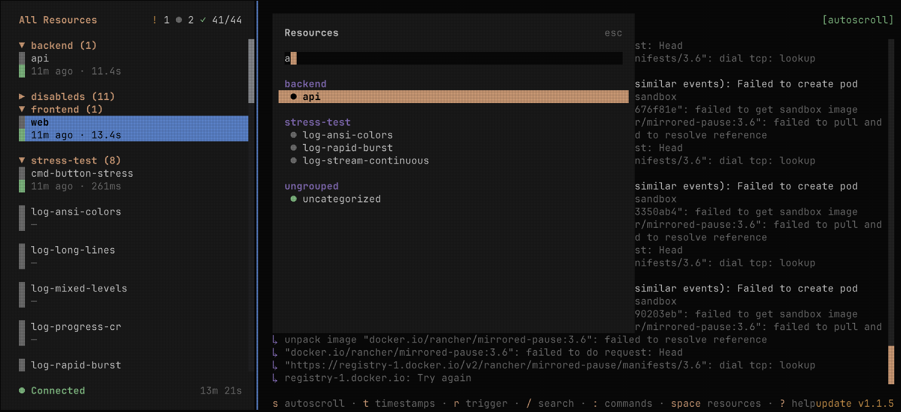

# Tilt Tui



## Requirements

- bun
- a running tilt process

## Running

### Dev Mode

bun install
bun dev

```

### Compile a Binary

compile a binary for the current platform

```

bun run build:binary:single

# then symlink built binary

$ which tui
tui: aliased to /home/ac/dev/tilt-tui-root/dist/tilt-tui-linux-x64/bin/tilt-tui

```

### Debugging

run debug command then click lick to open javascript debug console, or attach another debugger to port.

```

❯ bun run debug
$ SHOW_CONSOLE=true bun run --inspect-wait --conditions=browser --preload @opentui/solid/preload ./src/index.tsx
--------------------- Bun Inspector ---------------------
Listening:
ws://localhost:6499/de2t02omqqh
Inspect in browser:
<https://debug.bun.sh/#localhost:6499/de2t02omqqh>
--------------------- Bun Inspector ---------------------

````

## Using

`?` will show you list of context-aware keyboard shortcuts.

## Configuration

Tilt TUI loads user settings from `~/.config/tilt-tui/config.json`.

### Log Filters

Filter out noisy log lines using regex patterns. Create named filters to hide logs matching specific patterns.

Example `~/.config/tilt-tui/config.json`:

```json
{
  "logFilters": {
    "health-checks": [
      "GET /health",
      "GET /readiness"
    ],
    "debug-logs": [
      "^DEBUG:",
      "\\[debug\\]"
    ]
  }
}
````

Each filter:

- Has a **name** (displayed in the UI when active)
- Contains an array of **regex patterns** (JavaScript regex syntax)
- Filters are applied automatically when the config file is present

Active filters are shown in the log view header: `[logFilters: health-checks, debug-logs]`

### Theme

Choose a color scheme with the `theme` key in `~/.config/tilt-tui/config.json`:

```json
{
  "theme": "terminal"
}
```

Available themes:

- `default` — the built-in dark color scheme (used when no theme is set)
- `tokyo-night` — the Tokyo Night dark color scheme
- `terminal` — uses your terminal's own background and text colors, keeping accent colors for resource status
- `mono` — no color; uses your terminal's foreground on a transparent background, conveying state through icons and labels

The `terminal` and `mono` themes adapt to your terminal's light or dark background. An unrecognized value falls back to `default`. The `theme` key can be combined with `logFilters` in the same `config.json`, and is read at startup (restart Tilt TUI to apply a change).
