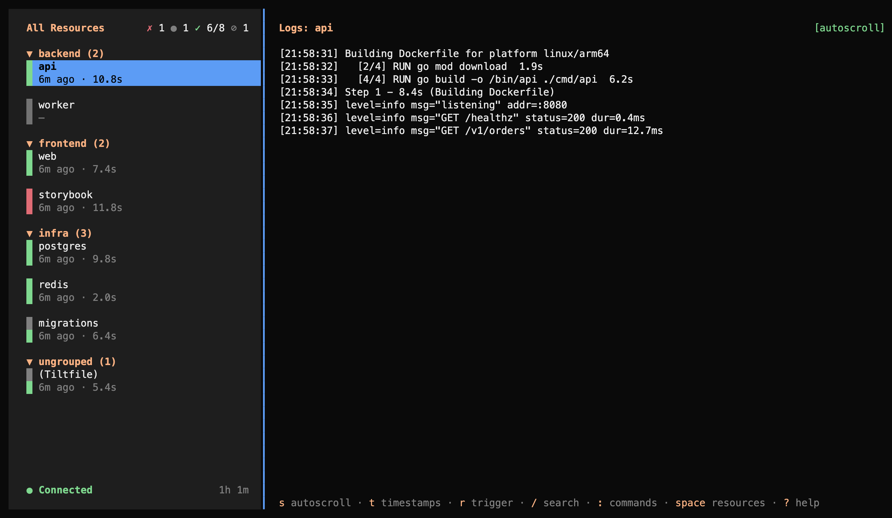
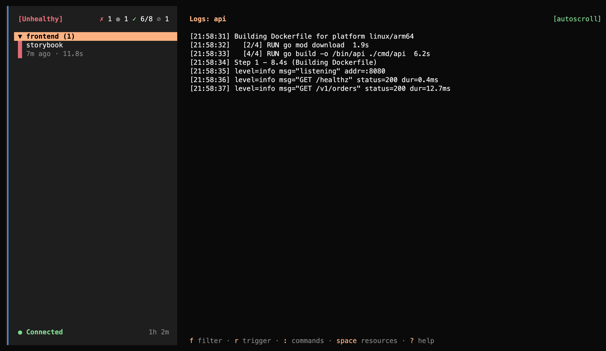
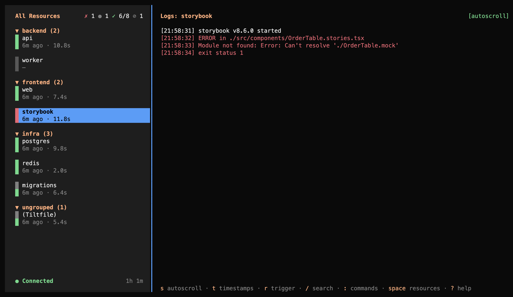
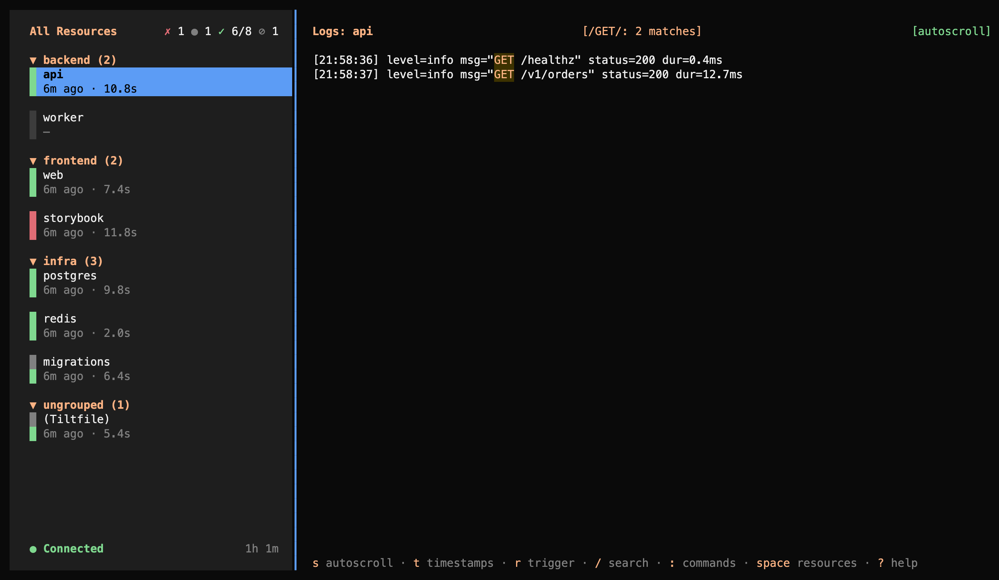
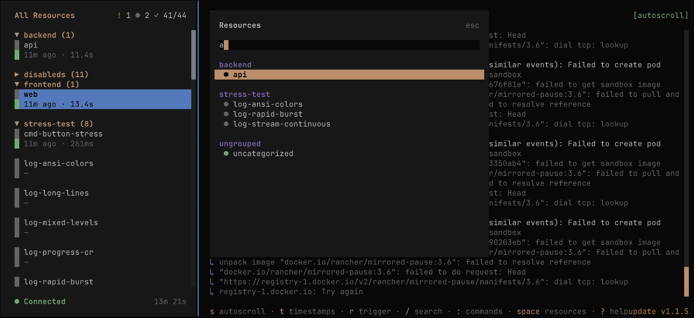
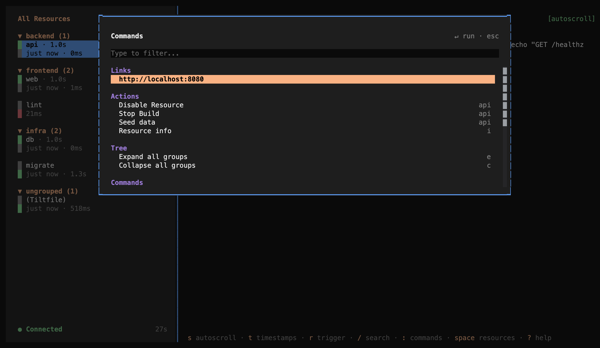
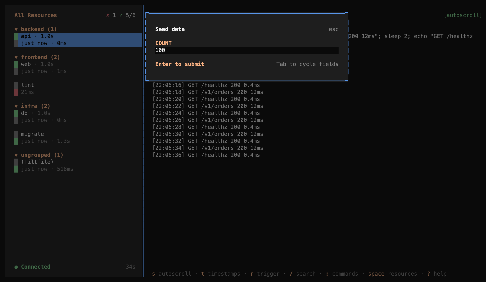
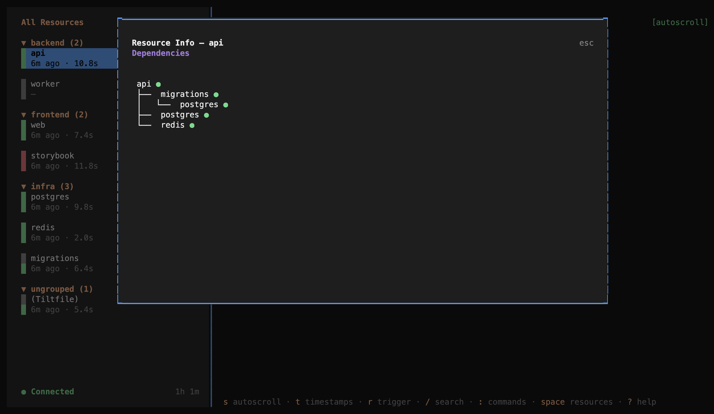
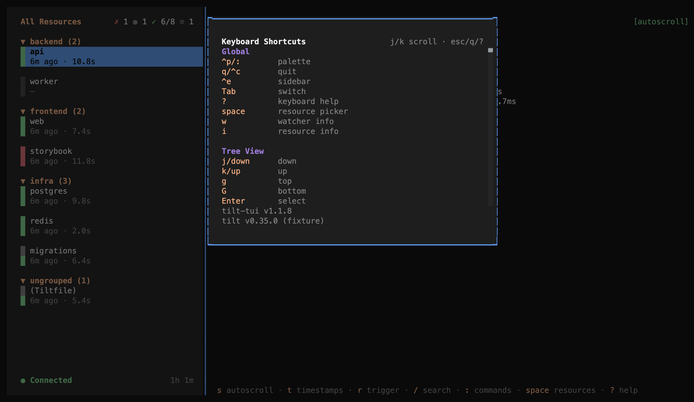

# tilt-tui

A terminal UI for [Tilt](https://tilt.dev), with vim-like navigation. Start
tilt from it with `tilt-tui up`, or attach it to a tilt that is already
running.



Website: <https://andycmaj.github.io/opentui-app/apps/tilt-tui/>

## Install

```sh
mise use -g github:andycmaj/tilt-tui
```

Prebuilt binaries for macOS and Linux (arm64, x64) come from
[GitHub releases](https://github.com/andycmaj/tilt-tui/releases), installed
with [mise](https://mise.jdx.dev).

## Requirements

- The `tilt` CLI on your `PATH`, or set `tiltBinaryPath` in the
  [config](#configuration).
- Nothing else needs to be running: `tilt-tui up` starts tilt for you. Plain
  `tilt-tui` attaches to a tilt you started yourself.
- [Bun](https://bun.sh) only to build from source.

## Usage

```sh
tilt-tui up                         # start `tilt up` and open the TUI
tilt-tui up -f deploy/Tiltfile api web   # args after `up` go to `tilt up` as-is
tilt-tui                            # attach to a running tilt on port 10350
TILT_PORT=10351 tilt-tui            # attach to one on another port
tilt-tui logs                       # print every resource's logs and exit
tilt-tui logs api -f                # follow one resource's logs
```

- **`tilt-tui up [tilt up args...]`** runs `tilt up` as a child process,
  passing every argument through (Tiltfile args, `-f`, `--port`, ...). It
  refuses to start if a tilt, or anything else, is already listening on that
  port, and shows tilt's own error if tilt fails to start. Quitting the TUI
  stops tilt.
- **`tilt-tui`** attaches to an existing tilt API on `localhost`, port
  `$TILT_PORT` or `10350`. Quitting leaves that tilt running.
- **`tilt-tui logs [resource] [-f] [--host] [--port]`** writes logs to stdout
  with no UI, for piping into `grep` or a file. With no resource it prefixes
  each line with the resource name; `-f` keeps streaming.

Press `?` in the TUI for every key binding, grouped by pane.

## Features

### Resource tree

Every resource Tilt manages, grouped by Tiltfile label like the Tilt web UI.
Each row has a status bar for runtime and build, when it last built and how
long the build took. A resource waiting on others shows which one is blocking
it. The header counts resources by status.

- `e` / `c` expand or collapse every group; `d` shows or hides disabled
  resources; `ctrl+e` hides the tree to give the logs the whole width.
- `f` cycles a status filter: all, healthy, unhealthy, building, pending.
  `esc` resets it.



### Logs

The right pane follows the selected resource's logs, build and runtime,
with long lines wrapped. `s` toggles autoscroll, `t` toggles timestamps, and
`j`/`k`, `g`/`G` and page up/down scroll.



### Log search

`/` filters the log to matching lines: plain text, or `/pattern/` for a
regular expression. The header shows the query and the match count; `esc`
clears it.



### Resource picker

`space` opens a fuzzy picker over every resource, grouped like the tree.
Picking one selects it, expands its group, clears a status filter that hid it,
and moves focus to its logs.



### Actions and the command palette

- `r` triggers a rebuild of the selected resource; `ctrl+d` disables or
  enables it.
- `:` or `ctrl+p` opens the command palette: the resource's endpoint links
  (opened in your browser), its Tilt buttons, global buttons, and every
  keybound command for the focused pane.



Buttons from the Tiltfile (for example the
[`uibutton`](https://github.com/tilt-dev/tilt-extensions/tree/master/uibutton)
extension) run from the palette. A button with inputs opens a form first:
text fields, checkboxes and choices.



### Resource and engine info

- `i` shows the selected resource's dependency tree (its `resource_deps`,
  recursively), with live status for each.
- `w` lists Tilt's file watches, which paths each resource watches, with a
  filter.



### Help and updates

`?` lists every key binding by pane, with the tilt-tui and tilt versions.



tilt-tui checks GitHub for a newer release on startup. When there is one, the
footer says so: click it to update in place with mise, or open the release
page from the command palette. Set `GITHUB_TOKEN` or `GH_TOKEN` to avoid
GitHub's anonymous rate limit.

## Configuration

tilt-tui reads `~/.config/tilt-tui/config.json` at startup (restart to apply a
change). Every key is optional:

```json
{
  "theme": "tokyo-night",
  "tiltBinaryPath": "/opt/homebrew/bin/tilt",
  "logFilters": {
    "health-checks": ["GET /health", "GET /readiness"],
    "debug-logs": ["^DEBUG:", "\\[debug\\]"]
  }
}
```

### Theme

- `default`: the built-in dark color scheme.
- `tokyo-night`: the Tokyo Night dark color scheme.
- `terminal`: your terminal's own background and text colors, keeping accent
  colors for resource status.
- `mono`: no color; your terminal's foreground on a transparent background,
  with state shown by icons and labels.

`terminal` and `mono` adapt to a light or dark terminal. An unknown value
falls back to `default`.

### tiltBinaryPath

The `tilt` binary to run, as a path or a command name. Without it, tilt-tui
uses the `tilt` on your `PATH`.

### Log filters

Hide noisy log lines with named groups of regular expressions (JavaScript
syntax). A line matching any pattern is dropped. The log header lists the
active filters, for example `[logFilters: health-checks, debug-logs]`.

## Development

```sh
bun install
bun dev                           # attach to a running tilt
bun dev up                        # or start one
TILT_TUI_FIXTURE=default bun dev  # canned session: no tilt, cluster or network
```

`TILT_TUI_FIXTURE` takes a built-in fixture name (`default`) or a path to a
JSON array of Tilt view messages, such as ones captured from a live
`/ws/view` socket. The website's demo is recorded with it, from
[`demo/demo.keys`](./demo/demo.keys).

Other scripts:

```sh
bun test
bun run typecheck
bun run build:binary:single   # binary for this platform in dist/tilt-tui-<os>-<arch>/bin/tilt-tui
```

### Debugging

`bun run debug` starts the app with the console open and waits for a debugger.
Open the printed `https://debug.bun.sh/...` link, or attach another debugger
to the port. Without it, `` ` `` toggles the console in any session, and
`SHOW_CONSOLE=true bun dev` starts with it open.

Built on [`@andycmaj/opentui-app`](https://github.com/andycmaj/opentui-app);
see [AGENTS.md](./AGENTS.md) for how the code is laid out.
